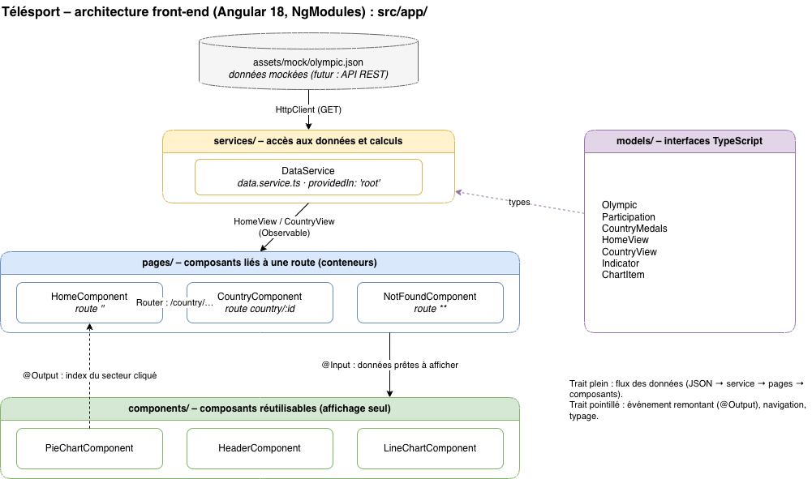

# ARCHITECTURE

## 1. Vue d'ensemble

- Application Angular 18 (NgModules) : 2 pages (Dashboard et détail pays) et une page « introuvable », données dans un fichier JSON (`assets/mock/olympic.json`, 5 pays).
- Point de départ : l'arborescence proposée par l'exercice, complétée à l'exercice 2 (états d'interface, validation des données, constantes, styles partagés, accessibilité).

## 2. Arborescence

```
src/
├── app/
│   ├── components/    composants réutilisables d'affichage
│   │   ├── header/
│   │   ├── pie-chart/
│   │   ├── line-chart/
│   │   └── status-message/
│   ├── pages/         composants liés à une route
│   │   ├── dashboard-page/
│   │   ├── country-detail-page/
│   │   └── not-found/
│   ├── services/      accès aux données, validation et calculs
│   │   ├── data.service.ts
│   │   └── olympic-validator.ts
│   ├── models/        interfaces TypeScript
│   └── constants/     constantes (couleurs des graphiques)
│       └── chart-colors.ts
└── styles/            partiels SCSS : _breakpoints, _layout, _colors
```

Schéma de l'architecture (réalisé avec draw.io, état de l'exercice 1 : il ne montre ni `StatusMessageComponent` ni `olympic-validator.ts`) :



## 3. Rôle de chaque élément

| Élément                                                        | Rôle                                                                                                             | Reçoit                                                       | Renvoie / émet                                                      |
|----------------------------------------------------------------|------------------------------------------------------------------------------------------------------------------|--------------------------------------------------------------|---------------------------------------------------------------------|
| `DataService`                                                  | Charge le fichier JSON, le fait valider, calcule les totaux et prépare les données de chaque page                | L'identifiant du pays (pour `getCountryView`)                | Des observables de vue-modèle : `DashboardView`, `CountryView`      |
| `olympic-validator.ts`                                         | Vérifie que les données reçues ont la forme attendue (gardes de type écrites à la main)                          | Des données de type `unknown`                                | Un `Olympic[]`, ou une erreur si une donnée est invalide            |
| Pages (`DashboardPageComponent`, `CountryDetailPageComponent`) | Récupèrent les données du service, portent l'état d'affichage (`status`), transmettent aux composants, naviguent | Les vues-modèles du service                                  | Rien. Dashboard reçoit l'index du camembert et navigue vers le pays |
| `HeaderComponent`                                              | Affiche le titre de la page et ses indicateurs (libellé + valeur)                                                | `pageTitle`, `Indicator[]`                                   | Rien                                                                |
| `PieChartComponent`                                            | Affiche le camembert de la page Dashboard                                                                        | `ChartItem[]`                                                | L'index du secteur cliqué (`number`)                                |
| `LineChartComponent`                                           | Affiche la courbe des médailles par année du pays                                                                | `labels` (années), `values` (médailles)                      | Rien                                                                |
| `StatusMessageComponent`                                       | Affiche les états `loading`, `empty` et `error` (spinner ou message)                                             | `status` (`ViewStatus` sans `'success'`), `message` (erreur) | Rien                                                                |
| `models/`                                                      | Définit les interfaces TypeScript des données et des vues, et le type `ViewStatus`                               | Sans objet                                                   | Sans objet                                                          |
| `constants/chart-colors.ts`                                    | Couleurs des graphiques, en valeurs JavaScript car Chart.js ne lit pas le SCSS                                   | Sans objet                                                   | Sans objet                                                          |

## 4. Flux de données

- Schéma simple : JSON → `DataService` (validation) → page (`status`) → composants d'affichage
- Selon l'état de la page, elle affiche soit ses composants (`success`), soit `StatusMessageComponent` (`loading`, `empty`, `error`).
- Ce qui descend (`@Input`) :
    - `DashboardPageComponent` donne `indicators` et `titlePage` à `HeaderComponent`.
    - `DashboardPageComponent` donne `chartItems` à `PieChartComponent`.
    - `CountryDetailPageComponent` donne `years` et `medals` à `LineChartComponent`.
    - Les deux pages donnent `status` (et `message` en cas d'erreur) à `StatusMessageComponent`.
- Ce qui remonte (`@Output`) :
    - `PieChartComponent` émet l'index du secteur cliqué (`itemSelected`), `DashboardPageComponent` reçoit l'index, retrouve le pays dans sa liste et navigue. Si le pays est introuvable, la page redirige vers `/not-found`.

## 5. Choix de conception

- Vue-modèle par page : la page reçoit des données prêtes à afficher, sans calcul.
- `ChartItem` générique : le graphique ne connaît pas le métier, il affiche libellé + valeur.
- Index émis par le camembert : le graphique ignore nom et id du pays ; la page retrouve le pays dans sa liste (même ordre que `chartItems`).
- `shareReplay(1)` dans le constructeur : un seul flux, une seule requête HTTP partagée entre les pages.
- État d'affichage dans la page : chaque page porte son champ `status` (`ViewStatus`). Le service ne connaît pas l'interface.
- Un seul composant pour les états non nominaux (`StatusMessageComponent`), dont l'entrée est typée pour exclure `'success'`.
- Validation stricte à la frontière : `DataService` reçoit le JSON typé `unknown` et le valide avant tout calcul. Les pages et les composants peuvent ensuite faire confiance aux types. Toute donnée invalide fait échouer le chargement.
- Couleurs : variables SCSS nommées par rôle pour les styles, constantes TypeScript pour Chart.js.
- Mise en page en grille CSS (mixin `page-grid` : 4, 8 ou 12 colonnes selon la largeur).
- `h1` « Olympic games app » dans `AppComponent`, pour que chaque page ait un titre de premier niveau ; le titre de page est un `h2` dans `HeaderComponent`.
- Alias de chemin : imports lisibles, sans `../../../..`.
- Route `/country/:id` : l'identifiant est stable et unique, alors que le nom peut changer ou contenir des caractères spéciaux (espaces, accents). Un id invalide ou inconnu redirige vers `/not-found` avec `replaceUrl`, pour que le bouton « précédent » ne ramène pas sur l'URL invalide.
- Les pages portent les noms des specs, avec le suffixe Component pour suivre le style guide.

## 6. Alternatives écartées

- **Dossiers par fonctionnalité** (`features/home`, `features/country`) : écartés. Il y a seulement deux pages, et elles partagent les mêmes composants (en-tête, graphiques) et le même service. Regrouper par fonctionnalité n'apporterait rien de plus que quatre dossiers par type.
- **Architecture hexagonale** : écartée. Il n'y a qu'une seule source de données et aucune règle métier complexe. Le seul changement prévu (fichier JSON vers API) ne touche que `DataService` et les modèles de données.
- **Clean architecture** : écartée. Séparer l'application en plusieurs couches (domaine, cas d'usage, infrastructure) ajouterait des fichiers et des interfaces pour de simples sommes et comptages.
- **État d'affichage dans le service** : écarté. Le service resterait lié à l'interface, alors que chaque page a ses propres états.
- **Validation tolérante** (ignorer les entrées invalides) : écartée. Les données alimentent des graphiques : une valeur vide ou incohérente fausserait les totaux, mieux vaut un échec explicite.
- **Bibliothèque de schémas (Zod, par exemple)** : écartée pour ce projet, car elle ajouterait une dépendance pour 5 pays. Elle est citée comme évolution dans le README.

## 7. Limites et suite

- `DataService` fait HTTP, validation et calculs : à scinder si l'application grossit.
- Évolution prévue : seuls `DataService` et les modèles de données changent ; les pages et composants ne sont pas touchés.
- Non fait, voir « Limites connues » du README :
    - constantes de routes et de libellés non factorisées
    - camembert non utilisable au clavier
    - pas de bouton « réessayer » en cas d'erreur
    - aucun test automatisé
